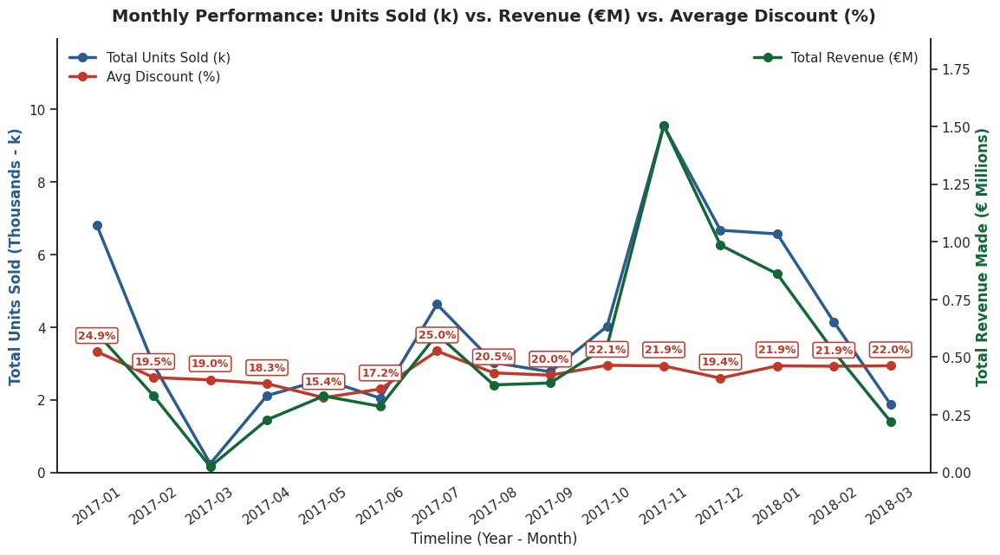
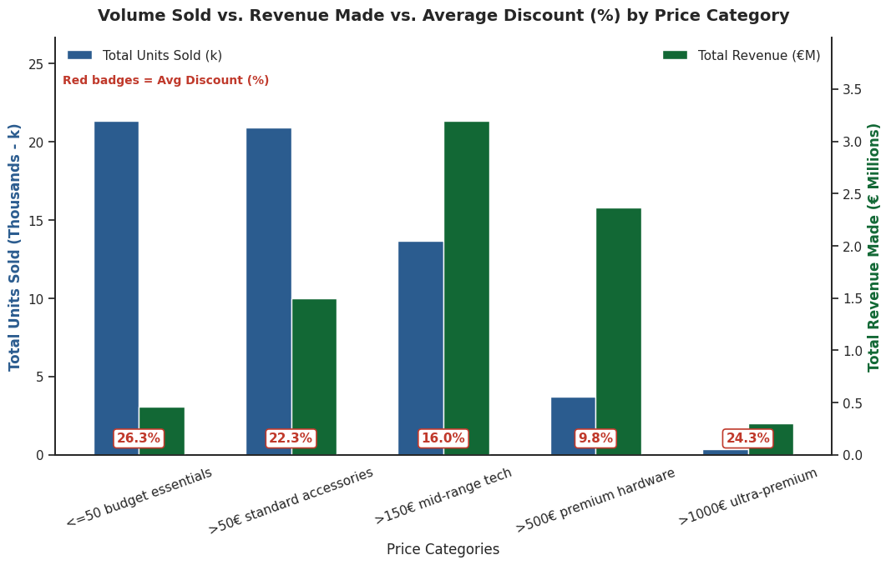
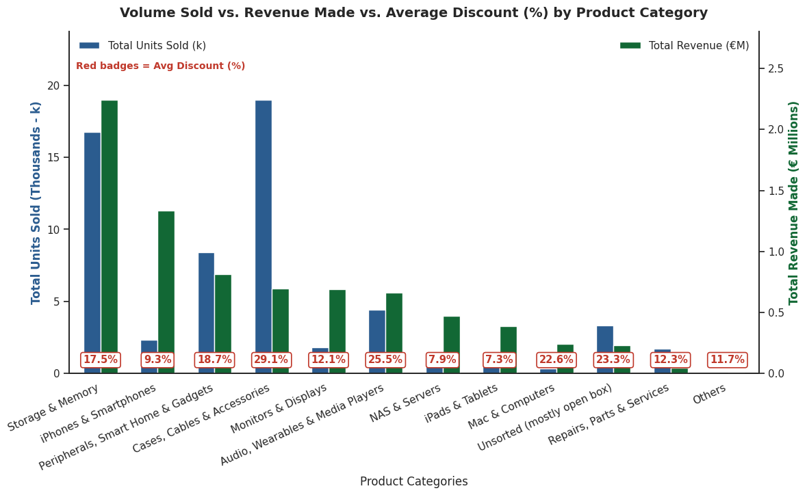
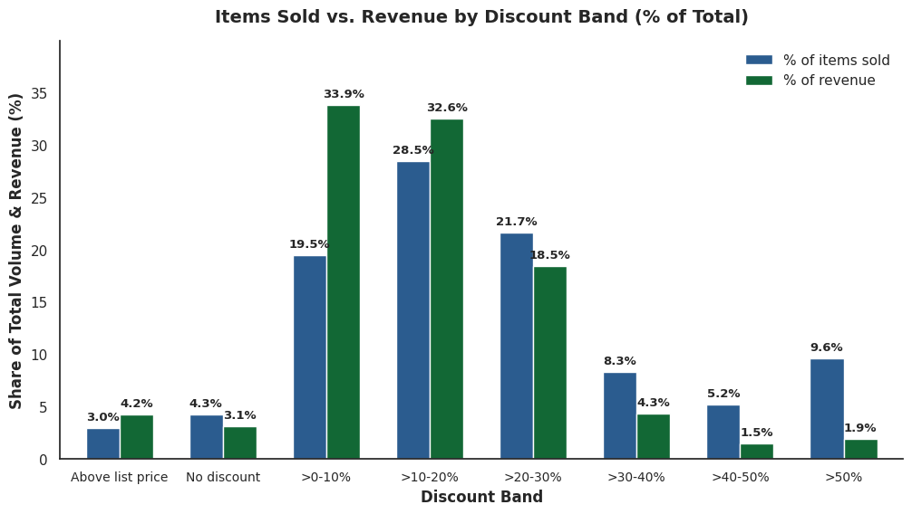

# Eniac Discount Analysis

**Does discounting actually help an online retailer? A Python data cleaning and analysis project.**


## Table of Contents
- [Overview](#overview)
- [Data](#data)
- [Key Findings](#key-findings)
- [Recommendations](#recommendations)
- [Business Questions](#business-questions)
- [Data Cleaning Process](#data-cleaning-process)
- [Visualisations](#visualisations)
- [Improving Data Collection](#improving-data-collection)
- [Project Structure](#project-structure)
- [How to Use](#how-to-use)
- [Tools](#tools)
- [Contact](#contact)

## Overview
Eniac is an online store selling Apple products and compatible accessories. Its leadership disagreed about discounts:

- **Marketing** believed discounts attract new customers and build loyalty.
- **The board** noticed that orders grew while revenue fell, and wants Eniac to be seen as a quality brand rather than the cheapest shop.

The goal: clean Eniac's messy sales database in Python and answer one question: **is discounting good for the business?**

**Our answer:** discount less, and more carefully. Nearly every sale is discounted all year round, yet sales follow the calendar (Black Friday, Christmas) rather than the size of the discount, and most revenue comes from small discounts.

This is a group case study from the **[WBS Coding School](https://github.com/WBSCodingSchool) Data Analytics Bootcamp**, completed with **Catalina Mayer** and **[Louise Gorman](https://github.com/louisegorman)**.

- Final presentation: [eniac-board-presentation.pdf](documentation/slides/eniac-board-presentation.pdf)

## Data
| Item | Detail |
|---|---|
| Source | Eniac's internal database, provided by WBS Coding School (orders, order lines, products, brands) |
| Period | 1 January 2017 to 14 March 2018 |
| Raw size | 226,909 orders, 293,983 order lines, 19,326 products |
| After cleaning | 40,985 completed orders, 53,231 order lines, 9,992 products |

**Limitations**
- Most raw orders were unfinished baskets, so only completed orders are used.
- All sales of €1,000 or more are missing (their prices were unreadable), so expensive products such as Macs are under-represented.
- There is no cost data: the analysis measures revenue, not profit.
- March 2017 is almost empty (241 items) and March 2018 ends on the 14th.
- Discount = (list price − price paid) ÷ list price, averaged over order lines.

## Key Findings
| # | Finding | Evidence |
|---|---|---|
| 1 | Discounting is the norm | 93% of items sold below list price; 96% of products discounted at least once |
| 2 | Discounts are large | 21% average per order line; €1.53M off a €9.34M list value |
| 3 | The calendar drives sales, not the discount | November (Black Friday) = €1.50M, 19% of revenue; average discount stays 15-25% all year |
| 4 | The "revenue drop" is seasonal | Revenue falls after Christmas every year; Jan and Feb 2018 beat Jan and Feb 2017 |
| 5 | Cheap items: big discounts, little revenue | Items under €50: 26% discount, 6% of revenue |
| 6 | Mid and high-priced items earn most | €150-€1,000 items: 71% of revenue with only 10-16% discounts |
| 7 | Top earners are not the most discounted | Accessories: 29% discount, €0.70M. iPhones: 9% discount, €1.33M |
| 8 | Small discounts bring most revenue | Discounts up to 20% generate about two thirds of revenue |

## Recommendations
1. **Stop blanket discounting** all year round.
2. **Lower discounts to about 10%** on items over €150, where each percentage point costs the most euros.
3. **Reserve deep discounts** for Black Friday, Christmas and stock clearance.
4. **Test first:** reduce discounts on a small product group and measure the effect on sales before rolling out.

## Business Questions
| Question | Answer |
|---|---|
| How many products are discounted? | 93% of items sold below list price; 96% of products discounted at least once |
| How big are the discounts? | 21.4% average (median 17.6%); 16.3% when weighted by euros |
| How do seasons affect sales? | Peak in November, high until Christmas, then a drop; discounts stay flat |
| How can products be categorised? | 9,992 products grouped into 12 categories (86 sub-categories) plus a condition column (New, Open box, Refurbished, Second hand) |
| How are prices spread by category? | Median prices range from about €2,700 (Mac & Computers) to about €40 (Cases, Cables & Accessories) |
| How could data collection improve? | See [Improving Data Collection](#improving-data-collection) |

## Data Cleaning Process
| Step | Notebook | What it does | Rows left |
|---|---|---|---|
| 1 | [`01_data-cleaning.ipynb`](scripts/01_data-cleaning.ipynb) | Removes duplicate products, handles missing values and text dates, fixes broken prices | 226,904 orders, 216,250 order lines, 9,992 products |
| 2 | [`02_data-quality.ipynb`](scripts/02_data-quality.ipynb)| Keeps completed orders only, removes €0 totals and unknown products, checks that amounts paid match products bought | 40,985 orders, 53,231 order lines |
| 3 |[`03_product-categories.ipynb`](scripts/03_product-categories.ipynb)| Adds sub-category, category and condition to every product | 9,992 products in 12 groups |
| 4 | [`04_analysis-charts.ipynb`](scripts/04_analysis-charts.ipynb)| Answers the business questions and produces the charts | 4 charts |

`brands.csv` needed no cleaning and was not used in the final analysis.

## Visualisations
**Sales follow the calendar; the discount stays near 20% all year**


**Cheap items get the biggest discounts but bring in little revenue**


**Accessories are discounted most; phones and tablets least**


**About two thirds of revenue comes from discounts of up to 20%**


## Improving Data Collection
- **Add automated input checks.** Unreadable prices (e.g. `1.137.99`) removed every sale of €1,000 or more.
- **Record discounts and shipping separately** so voucher discounts can be measured.
- **Record product costs** to analyse profit, not only revenue.
- **Keep the product catalogue complete and clean.** 1,354 orders referenced missing products, and some product codes were corrupted by spreadsheet formatting.

## Project Structure
```
├── README.md
├── data/
│   ├── raw-data/          # Original tables from Eniac
│   └── clean-data/        # Cleaned and quality-checked tables
├── scripts/               # Notebooks 01 to 04
├── documentation/
│   └── slides/            # Final board presentation (PDF)
└── images/                # Charts used in this README
```

## How to Use
1. **Quick look:** read the final presentation (PDF) for the 5-minute summary.
2. **Check the numbers:** open the notebooks in `scripts/` in order (01 to 04).
3. **Run it yourself:** open a notebook in Google Colab and run all cells. The notebooks load their input files directly from the `data/` folder of this repository, so no setup is needed.

## Tools
Python (pandas, seaborn), Google Colab, Google Slides

## Contact
- GitHub: [AliHaydar2023](https://github.com/AliHaydar2023)

